# Hi, I'm Andrey

I work on web applications with PHP, TypeScript, Vue, and Nuxt.
I also write small tools in Python.

## GitHub activity

  
  

Public GitHub stats, updated daily.

## Projects

- **[Textfilters](https://github.com/textfilters/textfilters)** — TypeScript packages for filtering text and moderating messages.
- **[Form 7 PDF Parser](https://github.com/alyldas/form7-pdf-parser)** — A Python library and CLI for reading shipping PDFs and adding order numbers.
- **[Site Media Checker](https://github.com/alyldas/site-media-checker)** — A tool for checking website icons and social preview metadata.
- **[Pixel Flags](https://github.com/alyldas/pixel-flags)** — Pixel-art country flags with a CSS API.
- **[md2pdf](https://github.com/alyldas/md2pdf)** — A Markdown-to-PDF converter with support for tables, code, and Mermaid diagrams.
- **[Theme Mode](https://github.com/alyldas/theme-mode)** — Light, dark, and automatic color modes for Nuxt and Vue.
