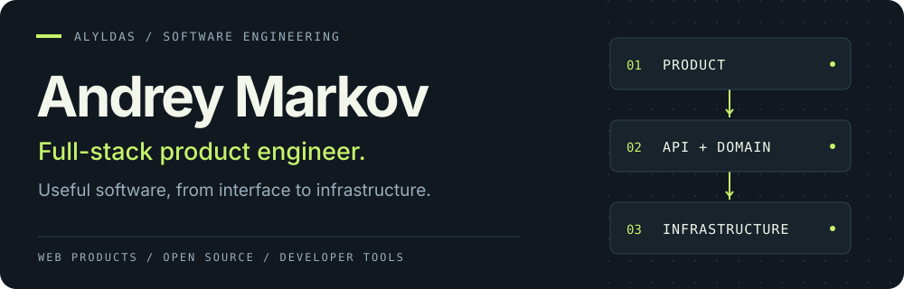

<picture>
  <source media="(prefers-color-scheme: dark)" srcset="./profile/header-dark.svg">
  <source media="(prefers-color-scheme: light)" srcset="./profile/header-light.svg">
  
</picture>

I build web products, developer tools, and the systems behind them.
My work spans TypeScript and PHP applications, Python tooling, and production infrastructure.

## Selected work

### [Textfilters](../../../../textfilters/textfilters)

**Composable text filtering and message moderation.** Detect and redact sensitive text, filter profanity, and apply actor-aware spam guards. Independent TypeScript packages with source-preserving offsets.

```ts
import { filter as email } from '@textfilters/email';

email.find('Contact hello@example.com');
// [{ start: 8, end: 25, value: 'hello@example.com', filter: 'email' }]
```

### [Form 7 PDF Parser](../../../form7-pdf-parser)

**Shipping PDFs → structured data + order labels.** A typed Python library and CLI that extracts recipients and tracking numbers, then adds order numbers to PDF pages.

Supports the new waybill layout with **«ОТ КОГО» / «КОМУ»** sections and legacy Form 7. Works with text-based PDFs; scanned documents need OCR first.

### [Site Media Checker](../../../site-media-checker)

**One URL. A complete media metadata check.** Inspect favicons, PWA icons, Open Graph, and Twitter/X cards, with previews for browser tabs, home screens, search results, and social platforms. Vue interface, Deno API, shared TypeScript contracts.

## Small tools, clear jobs

| Project | What it does |
| :--- | :--- |
| **[Pixel Flags](../../../pixel-flags)** | Pixel-art country flags with a familiar CSS API: `pf pf-ru`. |
| **[md2pdf](../../../md2pdf)** | Markdown → predictable A4 PDFs with tables, code, Mermaid diagrams, and ГОСТ-style formatting. |
| **[Theme Mode](../../../theme-mode)** | Auto, light, and dark modes for Nuxt and Vue, with framework-neutral helpers. |

## How I build

Explicit contracts. Small, useful abstractions. Observable, recoverable production systems.

**Applications** · TypeScript · Node.js · PHP · Python · Vue · Nuxt · Laravel  
**Data** · PostgreSQL · MySQL / MariaDB · Redis · S3  
**Operations** · Docker · Linux · Caddy / Nginx · CI/CD · Grafana · Prometheus

<details>
<summary><strong>GitHub activity &amp; languages</strong></summary>

Public GitHub snapshots, refreshed daily. Language shares describe repository code, not proficiency or time spent.




</details>
